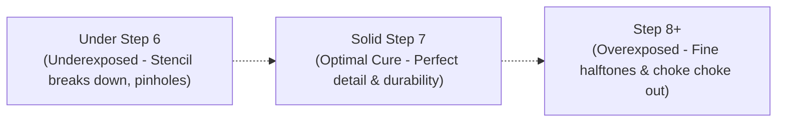

# Calculations: UV Exposure & 21-Step Wedge

**Department:** Darkroom  
**Applies To:** Darkroom Technician, Pre-Press  
**Tags:** `#darkroom` `#exposure` `#calibration` `#stepwedge`

---

## 1. 21-Step Transmission Guide Standard

When exposing screens on the vacuum UV LED unit, we target a **Solid Step 7** on the Stouffer 21-Step Sensitivity Guide.

- **Under Step 6:** Underexposed. Emulsion rinses away prematurely in wash-out tank.
- **Solid Step 7:** Optimal cure. Maximizes run durability while holding 2% to 95% dots at 55 LPI.
- **Step 8 or higher:** Overexposed. Fine positive lines lock up; small text and halftones fill in.

---

## 2. Standard Baseline Exposure Table (LED UV Unit)

*Values calibrated with single-cure LED unit at 100% vacuum (28 inHg).*

| Mesh Count | Color | Coating Method | Target Exposure (Seconds) |
| :--- | :--- | :--- | :--- |
| **110** | White | 1x1 Round Edge | **18.5 s** |
| **156** | Yellow | 1x1 Sharp Edge | **14.0 s** |
| **200** | Yellow | 1x1 Sharp Edge | **12.5 s** |
| **230** | Yellow | 1x1 Sharp Edge | **11.0 s** |
| **305** | Yellow | 1x1 Sharp Edge | **9.5 s** |

---

## 3. Step Wedge Calculation Formula

If a test burn produces a Solid Step $N$ and your target is Step 7:

$$\text{New Exposure Time} = \text{Current Time} \times 2^{\frac{7 - N}{2}}$$

*Example:*  
If current time is **12 seconds** and you only held a **Solid Step 5**:
$$\text{New Time} = 12 \times 2^{\frac{7 - 5}{2}} = 12 \times 2^1 = 24\text{ seconds}$$

> [!TIP]
> Perform a 21-step wedge test every 90 days or whenever cracking open a new emulsion manufacturer batch.

---

## Related Notes
- [[Darkroom/SOP - Screen Coating & Mesh Selection]]
- [[Equipment/Maintenance - Automatic & Manual Presses]]
