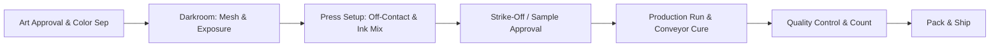

# 🖨️ Apex Printworks — Shop Knowledge Base

> **Single Source of Truth** for screen printing production, darkroom specs, ink formulas, press maintenance, and customer service reference.

---

## ⚡ Quick Navigation

| Department | Primary Notes & SOPs | Key Tags |
| :--- | :--- | :--- |
| **Darkroom** | [SOP - Screen Coating & Mesh Selection](/darkroom/sop-screen-coating-mesh-selection) [Calculations - UV Exposure & Step Wedge](/darkroom/calculations-uv-exposure-step-wedge) | `#darkroom` `#emulsion` `#mesh` |
| **Press Room** | [Formulas - Pantone 186C & Discharge Mixing](/press-room/formulas-pantone-186c-discharge-mixing) [Maintenance - Automatic & Manual Presses](/equipment/maintenance-automatic-manual-presses) | `#pressroom` `#ink` `#pantone` `#maintenance` |
| **Support / Front Desk** | [Customer FAQ - Print Guidelines & Turnaround](/support/customer-faq-print-guidelines-turnaround) | `#support` `#guidelines` `#turnaround` |

---

## 🧭 Shop Workflow Diagram

---

## 🔒 System Architecture (Why Git + Obsidian)

- **Local-First Speed:** Edits are made in Obsidian on your workstation (macOS, CachyOS, or Windows) with zero lag.
- **Automated Cloud Backup:** The **Obsidian Git** plugin synchronizes changes silently every 5 minutes to our secure GitHub repository.
- **Web Doc Portal (Astro Starlight):** Front desk, sales, and remote staff access this knowledge base instantly in a web browser without needing Obsidian.
- **Darkroom & Remote Codespaces:** Access and edit specs directly on a darkroom tablet or browser terminal with integrated **GitHub Copilot Business**.
